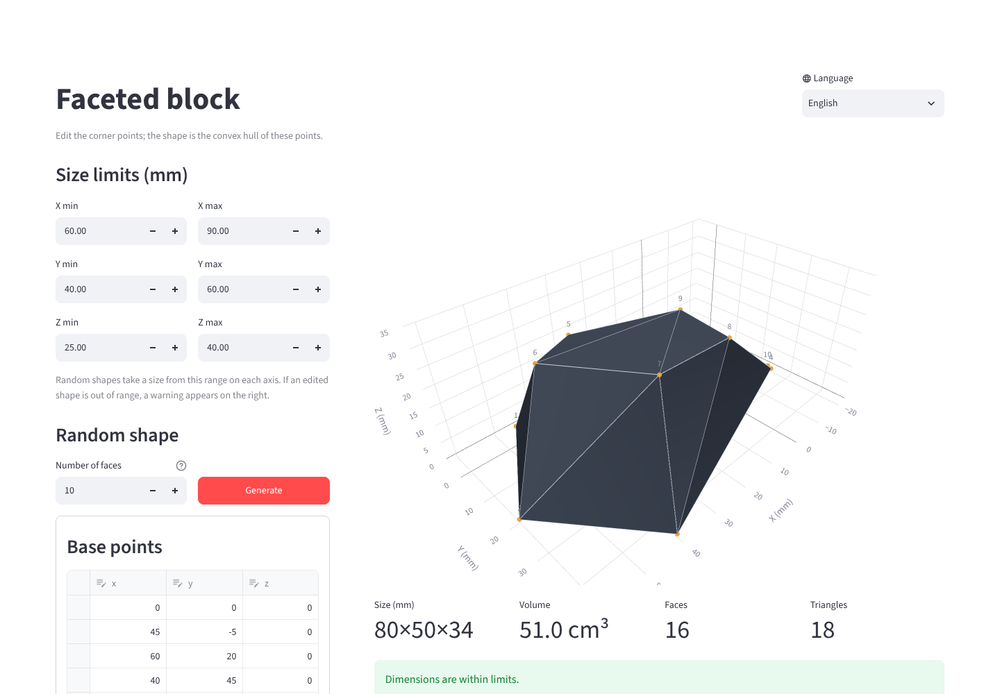

# Hullstone

[English](README.md) | **Türkçe**

Tarayıcıda düz tabanlı, düşük poligonlu taşlar (köşeli konveks bloklar) tasarla ve 3D baskı için STL olarak indir.

İsim **convex hull**'dan (konveks zarf) gelir: her taş, üretilen ya da elle düzenlenen bir nokta kümesinin zarfıdır.

**Online dene:** [ekagansahin.github.io/hullstone](https://ekagansahin.github.io/hullstone/). Kurulum gerekmez, tamamen tarayıcında çalışır.



## Özellikler

- **Rastgele şekil**: tam istenen sayıda düzlemsel yüze sahip (4–40) şekil üretir.
- **Boyut sınırları**: X, Y ve Z için mm cinsinden min/max girilir. Rastgele şekiller her zaman bu aralıkta çıkar.
- **Elle düzenleme**: taban ve üst noktalar tablolardan düzenlenir. Şekil bu noktaların konveks zarfıdır.
- **Sınır kontrolü**: düzenlenen şekil sınır dışındaysa hangi eksenin taştığı yazılır. **Sınırlara sığdır** yalnızca o eksenleri ölçekler.
- **Canlı 3D önizleme**: boyut, hacim, yüz ve üçgen sayısıyla birlikte.
- **STL indirme** (binary STL, milimetre).
- **4 dil**: English, Türkçe, Deutsch, Français. Sağ üst köşeden değiştirilir.

Şekiller her zaman konvekstir ve tabanı z = 0 düzleminde düz durur. Bu yüzden destek gerektirmeden basılır.

## Web sürümü

Online sürüm, aynı Streamlit uygulamasının [stlite](https://github.com/whitphx/stlite) ile tarayıcıda çalışan hâlidir (Python, WebAssembly'ye derlenmiş olarak çalışır). `index.html`, `hullstone_app.py` dosyasını doğrudan bu depodan yükler; böylece web ve yerel sürüm her zaman aynı kodu kullanır. İlk açılış, Python ve paketler indirilirken birkaç saniye sürer; sonrasında tarayıcı bunları önbelleğe alır.

## Yerelde çalıştırma

Python 3.10 veya üstü gerekir.

### Windows

1. Depoyu indir (**Code → Download ZIP**) ve klasöre çıkar.
2. `run_app.bat` dosyasına çift tıkla.

İlk çalıştırmada script `.venv` klasöründe bir sanal ortam kurar ve paketleri yükler. Bu birkaç dakika sürer. Python yüklü değilse `winget` ile kurar. Sonraki açılışlar hemen başlar. Uygulama tarayıcıda açılır, kapatmak için konsol penceresini kapat.

### macOS / Linux

Terminalde, proje klasörünün içinde:

```bash
python3 -m venv .venv
source .venv/bin/activate
pip install -r requirements.txt
streamlit run hullstone_app.py
```

İlk kurulumdan sonra yalnızca `source .venv/bin/activate` ve `streamlit run hullstone_app.py` yeterli.

## Kullanım

1. Her eksen için **boyut sınırlarını** (mm) gir.
2. **Yüz sayısını** seçip **Rastgele üret**'e tıkla. Ya da **Taban noktaları** ve **Üst noktalar** tablolarını düzenleyip **Şekli güncelle**'ye tıkla.
3. Önizlemeyi ve altındaki değerleri kontrol et. Uyarı çıkarsa **Sınırlara sığdır**'a tıkla.
4. **STL indir**'e tıkla ve dosyayı her zamanki gibi dilimle.

İpuçları:

- Zarfın içinde kalan noktalar şekli değiştirmez.
- Düz bir alt yüzey için taban noktalarında `z = 0` tut.
- Uygulamayı doğrudan bir dilde açmak için adrese `?lang=tr`, `?lang=de` ya da `?lang=fr` ekle.

## Nasıl çalışır

- **Şekil**: mesh, tüm noktaların konveks zarfıdır (`scipy.spatial.ConvexHull`). Her üçgenin normali gerekirse dışa çevrilir. Aynı düzlemdeki üçgenler tek yüz sayılır.
- **Rastgele üretim**: taban bir elips üzerindeki k kenarlı çokgendir, üst noktalar bir elipsoid kubbenin üzerindedir. Gereken üst nokta sayısı Euler formülünden gelir:
  `yüz = 2 × üst nokta + k − 1`. Rastgele bir eğiklik (shear) bloğu asimetrik yapar. Yüz sayısı tam tutana kadar yeniden denenir.
- **Boyut sınırları**: şekil, sınırlardan seçilen hedef boyuta her eksende ayrı ölçeklenir. Bu bir afin dönüşümdür. Bu yüzden düzlemsel yüzler düzlemsel, şekil konveks kalır ve yüz sayısı değişmez.

## Proje yapısı

```
hullstone_app.py     Streamlit uygulaması (arayüz, geometri, STL çıktısı)
i18n.py              Tüm diller için arayüz metinleri
assets/icon.png      Uygulama ikonu (favicon)
run_app.bat          Windows için tek tıkla başlatıcı
hullstone_script.py  Sade script sürümü: noktaları dosyada düzenle, STL yazar
requirements.txt     Python bağımlılıkları
LICENSE              MIT lisansı
index.html           GitHub Pages için web sürümü (stlite)
```

## Yeni dil ekleme

`i18n.py` içinde `LANGS`'e dil kodunu ve adını ekle, sonra `STRINGS` içindeki her girdiye o kodun çevirisini yaz. Eksik bir çeviri varsa uygulama İngilizce metni gösterir.

## Lisans

[MIT](LICENSE) © 2026 Eyup Kağan Şahin. Lisans notu korunduğu sürece proje ticari kullanım dahil serbestçe kullanılabilir, değiştirilebilir ve paylaşılabilir.
